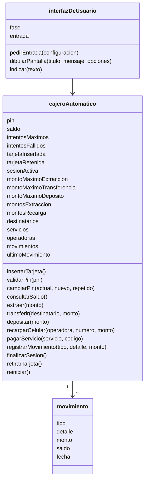

# Análisis orientado a objetos

## Casos de uso

- Iniciar sesión con tarjeta y PIN.
- Consultar saldo.
- Retirar dinero.
- Transferir.
- Depositar dinero.
- Recargar celular.
- Pagar servicios.
- Cambiar PIN.
- Imprimir comprobante.
- Finalizar sesión.
- Recibir guía del asistente.

## Actores

- Persona usuaria.
- Asistente de guía (sistema).

## Diagrama de clases

## Estados del cajero

espera, pin, menu, saldo, monto, otroMonto, confirmarMonto, rechazo, retiroBilletes, preguntaComprobante, retiroTarjeta, bloqueo.
